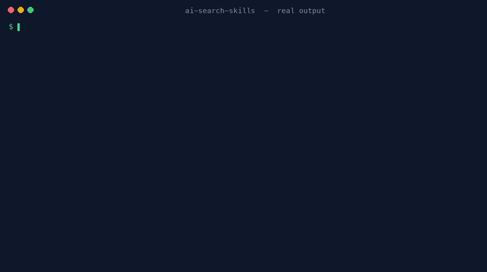

# AI-search visibility skills for Claude Code, Cursor and Codex

Seven open-source skills that answer one question: **can AI assistants find your site, read it, and say the right thing about it?** Each skill is a `SKILL.md` plus a small script that runs on the Python standard library (3.8+). No account, no dependency install, no MCP server. Tests run offline.



*Real output from the scripts, truncated to fit. The first scene reads nytimes.com's public robots.txt on 23 Nov 2026 (it blocks the AI crawlers; the point is the per-crawler verdict, not a judgement of the site). The last scene is a single real probe run of one question, shown truncated.*

## Install

```bash
npx skills add citedby-eu/ai-search-skills
```

One skill: `npx skills add citedby-eu/ai-search-skills --skill ai-crawler-access`. Or clone the repo and run the scripts directly, they do not need an agent.

Then ask your agent: *"Run the ai-visibility-audit skill on example.com."*

No agent? The crawler-access check also runs in a browser, with the date of the check on the result: [citedby.eu/tools/ai-crawler-check](https://citedby.eu/tools/ai-crawler-check?utm_source=github&utm_medium=repo&utm_campaign=ai-search-skills&utm_content=crawler_tool). If your ChatGPT visibility dropped on one date, [check access first](https://citedby.eu/blog/chatgpt-visibility-dropped-to-zero?utm_source=github&utm_medium=repo&utm_campaign=ai-search-skills&utm_content=visibility_zero).

## The skills

| Skill | What it does | Script |
|---|---|---|
| [`ai-crawler-access`](skills/ai-crawler-access/SKILL.md) | One robots.txt verdict per AI crawler (search vs user-fetch vs training), RFC 9309 matching, reads robots.txt only by default; an opt-in `--live-probe --confirm-permission` (own site or permission to test) also shows what your server answers to each bot's user-agent string, a lead for CDN/firewall blocks, not what the real crawler sees | `check_crawlers.py` |
| [`llms-txt`](skills/llms-txt/SKILL.md) | Validate an llms.txt (soft-404 HTML, missing H1, relative links, dead links) or generate one from your sitemap | `llms_txt.py` |
| [`schema-check`](skills/schema-check/SKILL.md) | The JSON-LD a crawler without JavaScript sees; missing required/recommended properties on Organization, Product/Offer, Article, WebSite, FAQPage | `schema_check.py` |
| [`citation-probe`](skills/citation-probe/SKILL.md) | Ask assistants your buyer questions N times with web search on, log who is named and which URLs are cited (JSONL), report "named in X of N" | `probe.py` |
| [`citation-gap`](skills/citation-gap/SKILL.md) | From the probe logs: which domains and page types get cited where you do not | `gap.py` |
| [`brand-answer-audit`](skills/brand-answer-audit/SKILL.md) | What AI answers say about *you* (price, plans, what you do) against facts you wrote down; rows to check by hand | `brand_audit.py` |
| [`ai-visibility-audit`](skills/ai-visibility-audit/SKILL.md) | Runs the six in the right order and writes one report | none |

## How this relates to Illyism/seo-skills

[Illyism/seo-skills](https://github.com/Illyism/seo-skills) is the broader and better-known repo: 30 skills across technical SEO, content, links and copy, with more than 2,000 stars (read 23 Nov 2026). We read it before writing this one and did not copy from it. If you need on-page SEO, content refreshes, link building or copywriting, use that.

What this repo does differently, narrowly:

- **AI-search only, and runnable.** Its `aiseotracker`, `ai-seo-report` and `content-coverage` skills work through the AI SEO Tracker service (its `seo-autopilot` asks the assistants by hand instead). Here the checks run locally with your own API keys, or none for the first three skills.
- **Per-crawler verdicts by role, as a script.** Its `seo-roast` already checks robots.txt for default-deny and tells the agent to keep AI search open while blocking training crawlers; it also fetches a pricing page as four AI user-agents with `curl`. `ai-crawler-access` is a tested script that applies the robots.txt rules per crawler, separates search, user-fetch and training crawlers, and compares what your server answers to each bot string.
- **llms.txt and JSON-LD checkers** that run on the raw HTML.
- **A brand-answer audit** for wrong prices and facts in AI answers, and a citation gap computed from your own probe logs.

It has things we do not: 23 more skills, a web catalog, MCP servers wired in, real traction.

## Honesty rules the skills follow

- Report **"named in X of N runs"**. Never a rank, a score out of 100, or a promised mention.
- 5 or more runs per question, repeated on 3 or more days, raw JSONL kept.
- API answers are not the consumer apps' answers. Every report says so.
- A flagged row is a place to look. Count what you confirmed by hand.
- There is no published evidence that AI search crawlers read `llms.txt`. The skill treats it as hygiene, not a lever. [Our write-up](https://citedby.eu/blog/does-llms-txt-work).
- Provider status for `citation-probe`: `anthropic` tested live on 23 Nov 2026. `gemini`, `openai`, `perplexity` are written from the vendors' docs and tested on fixtures only. Model names change; pass `--model provider=name`.

## Run the tests

```bash
python3 -m unittest discover -s tests
```

28 offline tests: robots.txt matching, llms.txt rules, JSON-LD parsing, provider response parsing, gap and brand-audit logic.

## Why we wrote it

[CitedBy](https://citedby.eu/?utm_source=github&utm_medium=repo&utm_campaign=ai-search-skills) audits websites for AI search and gives the exact fix per page. These are the checks we run, minus the crawl of your whole site, the page-by-page fixes and the re-measure. **The first check is free: https://citedby.eu/?utm_source=github&utm_medium=repo&utm_campaign=ai-search-skills**

Issues and pull requests welcome. Open one if a check is wrong on your site: we count a check that is false on more than 1 page in 10 as not measured.

MIT licence. Maintained by the CitedBy team (hello@citedby.eu). Crawler roles follow each vendor's public bot documentation (OpenAI, Anthropic, Perplexity); check them, they change.
